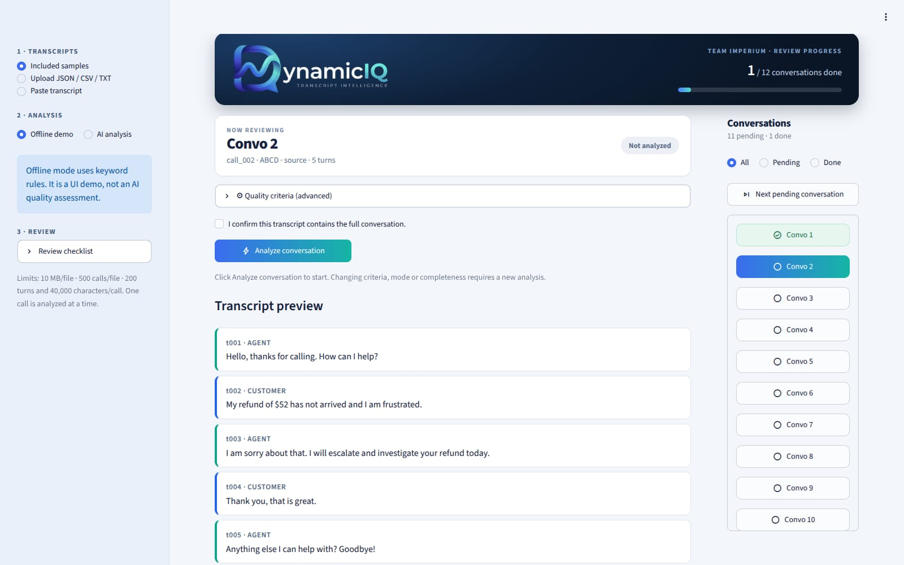

<div align="center">


### Call-transcript quality review that shows its receipts.

Every finding is backed by an **exact quote**. Every conversation gets a **reviewer sign-off**.

<p>
  
  
  
  
  
  
  
</p>

</div>

---

## What is DynamicIQ?

DynamicIQ reads customer-support call transcripts and tells a reviewer **what happened, how the customer felt, and where quality slipped**, without trusting the model blindly.

The AI proposes findings. The app **verifies every quote against the transcript** and withholds anything it can't prove. Then a human reviewer accepts or rejects each finding, adds remarks, and marks the conversation **done**, so nobody reviews the same call twice.

<div align="center">
  
</div>

## Features

| | |
|---|---|
| 🎯 **Issues & outcomes** | Each customer issue is tracked separately as resolved, unresolved, pending or unknown. A polite "thanks" is not treated as resolution. |
| ✅ **Quality checklist** | Configurable criteria with weights, scored on assessed checks only. Unknowns never count against the agent. |
| 📈 **Sentiment per turn** | Customer turns only, with a trend chart and the exact quote behind each label. |
| 🚩 **Risk flags** | Disrespectful wording, unanswered final questions and similar red flags, each with evidence. |
| 🔎 **Evidence highlighting** | Pick any finding and see its exact quote highlighted inside the transcript. |
| 🧾 **Quote verification** | Citations that don't match the transcript text exactly are rejected and listed, not shown as fact. |
| 🕳️ **Gap-aware** | Missing or truncated transcript sections are detected; absence-based failures are never scored on incomplete calls. |
| 🗂️ **Conversation queue** | Every conversation is listed as **Convo 1, Convo 2, …** on the right with All / Pending / Done filters. |
| ✔️ **Mark as done** | One click saves the review, locks the conversation and jumps to the next pending one. It survives a refresh. |
| 💬 **Remarks that save** | Decision + remark per finding with an explicit **Save** button (Enter works too). |
| ⬇️ **Exports** | Full JSON report and a one-finding-per-row CSV, with spreadsheet-formula injection neutralised. Neither export contains your API key. |
| 🔌 **No key? No problem** | Offline demo mode runs keyword rules so you can try the whole UI without any credentials. |

<div align="center">
  
</div>

## Quick start

Python 3.11 or 3.12. On Windows with VS Code + Git Bash:

```bash
python -m venv .venv
source .venv/Scripts/activate        # macOS/Linux: source .venv/bin/activate
python -m pip install -r requirements.txt
python -m streamlit run app.py
```

Open http://localhost:8501. Offline demo works immediately.

> `py` instead of `python` if `python` isn't found on Windows.

## Enable AI analysis

Create a `.env` file next to `app.py`:

```dotenv
OPENAI_API_KEY=your_api_key_here
OPENAI_MODEL=your_model_name
```

Restart the app, pick **AI analysis** in the sidebar, choose a conversation and hit **Analyze conversation**.

- The key is **read from `.env` only** and is never displayed or exported.
- `analyzer.py` calls an OpenAI-compatible Chat Completions endpoint (currently configured for Groq). The model must support **strict JSON Schema outputs**.
- Incomplete conversations are blocked in AI mode with *"Cannot analyse: Missing key sentiment points"*.
- **Never commit `.env`.** It's already in `.gitignore`.

## Review workflow

1. **Load** transcripts from the sidebar: included samples, upload (JSON / CSV / TXT) or paste.
2. **Pick** a conversation from the right-hand list.
3. **Analyze** it.
4. **Review** each finding: choose a decision, write a remark, click **Save**.
5. **Mark as done**. The review is saved to `reports/`, the conversation turns green, and you move on.

Need to change something later? **Reopen for review** unlocks it.

## Input formats

JSON accepts:

- The wrapper `{"metadata": {...}, "conversations": [...]}`
- A list of call records, or a single call object
- Original ABCD records: `convo_id` + `original: [["agent", "..."], ...]`
- Normalised records: `conversation_id` + `turns: [{"speaker": "customer", "text": "..."}]`

CSV: one call per row with `conversation_id` and either `turns_json` or `transcript`.
TXT / paste: `Agent:` and `Customer:` lines; unlabelled lines continue the previous turn.

Turn IDs are normalised to `t001, t002, …`. Missing text becomes a visible gap marker. Action events are kept as `system`, not customer speech. Evaluation labels and source metadata are never sent to the model.

**Limits:** 10 MB per upload · 500 conversations per file · 200 turns and 40,000 characters per call. Oversized input is rejected, never silently truncated.

## How scoring works

```
score = 100 × (weight of passed checks) / (weight of passed + failed checks)
```

- Outcomes per check: `pass`, `fail`, `unknown`, `not_applicable`.
- `unknown` and `not_applicable` are **excluded** from the score; assessment coverage is shown next to it.
- Missing or duplicate model results become `unknown`.
- Absence-based failures need a reviewer-confirmed complete transcript. Known gaps override that confirmation.
- Reviewer decisions **never silently change** the generated score.

## Project structure

```
DynamicIQ/
├── app.py              Streamlit UI: queue, review forms, evidence view, exports
├── analyzer.py         AI request, safe error handling, offline rules, orchestration
├── helpers.py          Parsers, exact-quote checks, completeness guards, scoring, CSV
├── schemas.py          Pydantic input/output contracts
├── criteria.json       Editable QA criteria and weights
├── test_project.py     Regression tests (no paid API calls)
├── logo.jpeg           Brand logo (also used in the app header)
├── .streamlit/         Theme config (light)
├── samples/            Mixed dataset + edge cases
└── reports/            Saved reviews + done status (git-ignored, created on demand)
```

## Tests

```bash
python -m unittest -v test_project.py
```

Covers all 85 samples, exact-quote rejection, incomplete evidence, unknown speakers, malformed input, scoring, CSV round-trips, API error handling and evaluation-label leakage. AI responses are mocked; no live API test is claimed.

## Honest limitations

- Exact-quote matching proves a quote **exists**, not that it **supports** the interpretation. Human review still matters.
- Offline demo is a keyword UI demo, not an AI quality assessment.
- Dataset QA outcomes aren't gold-labelled. The 15 modified edge cases carry authored expectations, not independent validation.
- No authentication, database or multi-team access control. Done-status lives in local files, so one shared `reports/` folder means one shared review state.
- No audio transcription or PDF ingestion. Source text isn't auto-anonymised.
- Keep parent and modified records together via `group_id` if you split data for training. Preserve dataset licences in `samples/` when redistributing.

## Built by

**Team IMPERIUM**. Built for the hackathon, designed to survive a reviewer.

---

<sub>

**GitHub topics to add:** `streamlit` · `python` · `nlp` · `llm` · `call-center` · `customer-support` · `quality-assurance` · `sentiment-analysis` · `transcript-analysis` · `structured-outputs` · `pydantic` · `hackathon`

</sub>
